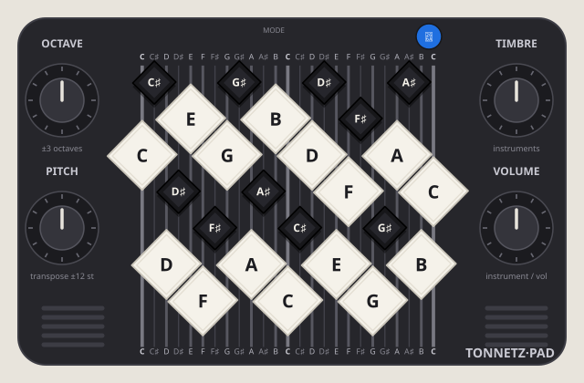

# Tonnetz Pad — 25-Key Parallelogram Keypad Design Spec

A Cubyfun EasyPlay-style keypad whose **25 keys are identical parallelograms
placed on your Tonnetz grid's 25 nodes**, so the physical layout *is* the
harmony: chords are triangles, scales are paths. Each key's **top and bottom
corners sit exactly on its vertical pitch line** (x = chromatic pitch), so the
keybed reads left → right as ascending pitch.

The front-panel drawing is in the companion canvas **"Tonnetz Pad — 25-Key
Parallelogram Front Panel (SVG)"** — it reuses your SVG's exact node coordinates.
Every key is the *same* parallelogram: the lattice's fundamental Voronoi cell
with its two chamfer corners removed, so the top and bottom vertices land on
the node's pitch line.
of the lattice (taken from a fully-interior node, then translated to each of
the 25 nodes), so all keys are congruent — no more oversized edge keys.

## 1. The grid (your SVG, verbatim)

7 staggered rows, 25 nodes total (10 black / 15 white in your drawing):

| Row (top → bottom) | keys left → right |
|---|---|
| 1 | C♯ · G♯ · D♯ · A♯ (all black) |
| 2 | E · B · F♯ (black) |
| 3 | C · G · D · A (all white) |
| 4 | D♯ · A♯ (black) · F · C (white) |
| 5 | F♯ · C♯ · G♯ (all black) |
| 6 | D · A · E · B (all white) |
| 7 | F · C · G (all white) |

(The node you labeled G♭ is now labeled **F♯** — same pitch class, all-sharps
spelling.)

Axes (as in your drawing):

- **red, horizontal** = perfect fifth, +7 semitones (C–G–D–A …)
- **green, down-left diagonal** = major third, ±4 semitones
- **yellow, wavy down-right diagonal** = minor third, +3 semitones

Verified: every red/green/yellow connection in your SVG is exactly +7 / +4 / +3
semitones. Major triads = upward triangles (C·E·G), minor triads = downward
triangles (C·D♯·G).

*(On the front panel the colored axis lines are **not printed** anymore — see
§5. They remain the harmonic reference for firmware logic, not the panel
graphics.)*

## 2. Key shape — one uniform parallelogram for every key, piano-style black keys

- **All 25 keys use the same parallelogram** (4 vertices, area ≈1631 grid
  units²): taken from the Voronoi cell of interior node D (200,110) with the
  two chamfer corners dropped, giving vertices at top `(x, y−28.56)`,
  right `(x+28.56, y−0.66)`, bottom `(x, y+28.56)`, left `(x−28.56, y+0.66)`
  relative to each node — **the top and bottom corners lie exactly on the
  node's vertical pitch line** x = const. All 25 keys are congruent.
- The parallelogram keeps the lattice slant (right corner 0.66 above center,
  left corner 0.66 below), so neighboring keys still tile in the Tonnetz
  directions.
- **White keys**: ivory parallelograms (`#f5f2ea`) with an inner outline
  (×0.86 of the shape, stroke `#e3ded2`) — the visual floor of the keybed.
- **Black keys (♯)**: the *same* parallelogram shrunk (×0.62) drawn **on top**
  with a drop shadow (+3.2 y) and a domed highlight (×0.72 of the black shape)
  → smaller, darker, raised — exactly the piano black-key feel over white keys.
- Note name printed inside each key (dark on white, light on black).
  Legend top-left: vertical line = chromatic pitch, left → right.
- Actuation: each hexagon is a keycap on a tactile switch (silicone membrane),
  travel 1.5–2 mm; the hexagon outline is the keycap edge.
  Optional: per-key LED ring in the seam for scale/chord highlighting.

## 3. Around the keys (EasyPlay-inspired)

- **Four equal knobs (r=40, 12 ticks, cap + needle), two per side**:
  - **left side** — top **OCTAVE** (±3 octaves), bottom **PITCH / transpose**
    (±12 st), both centered at x=68 (y=110 / y=250);
  - **right side** — top **TIMBRE** (instrument selection), bottom **VOLUME**,
    both centered at x=566 (y=110 / y=250).
  Each knob has its name above and a sub-label below.
- **Speaker grilles** (5 bars) at the bottom of each side column.
- **Top-right: one accent function key** — blue ♪ MODE (free → scale-highlight →
  chord-play); the MODE caption sits top-center.
- Body ≈ **320 × 210 mm** dark ABS; USB-C + LiPo inside.
- Placement is collision-checked: the key field (`translate(76,24)
  scale(1.33)`, panel x ≈ 118–513) clears all four knobs, both grilles, the
  buttons, the caption and the branding.

## 4. Electronics / firmware

- MCU RP2040 or ESP32-S3; 25 keys scanned as a matrix; 2 encoders; optional
  25 × WS2812 in the seams; mono class-D amp + speaker.
- Each key sounds the pitch of its **column**: st = (x−60)/10 semitones from C4,
  so x=180 is one octave above x=60 and the rightmost C (x=300) is **+2
  octaves**. The PITCH knob transposes ±12 st and relabels the key labels and
  pitch-line labels accordingly; the OCTAVE knob shifts ±3 octaves on top.
- **Chord mode**: pressing a key plays its triad — major on white keys, minor on
  black keys — and the triad's keys light up. **Scale mode**: the natural keys
  glow, sharps dim. **REC/PLAY loop removed** (deemed useless).

## 5. Layout: original grid positions; pitch-order lines replace the colored axes

- All 25 keys sit at the **original draw.io node coordinates** — no compaction,
  no nudges, no cuts. Every key is the full uniform hexagon.
- The **red/green/yellow axis lines are removed from the panel** (they fought
  with the keys in the seams).
- Instead, **one vertical line per key column** is printed behind the keys
  (`#pitch-lines` group): x = 60…300 step 10, spanning grid y = 36…268 (short
  enough to clear the MODE key at the top). Since x encodes
  chromatic pitch (60=C, 70=C♯, … 170=B, 180=C, … 300=C), the lines read
  **left → right = ascending pitch** — and each key's top/bottom corners
  touch its own line (§2).
- **Natural-scale lines (C D E F G A B → x = 60, 80, 100, 110, 130, 150, 170,
  180, 200, 220, 230, 250, 270, 290, 300) are thickened** (w 2.2, `#5c5c66`)
  vs. sharp lines (w 1, `#45454e`); the three C columns (x = 60, 180, 300)
  are brightest (w 2.8, `#82828c`).
- Each line gets a tiny note-name label at **both ends**: `#pitch-labels-top`
  (grid y = 31, just above the line tops, clear of the top black-key row) and
  `#pitch-labels` (grid y = 274, at the feet). Naturals brighter, C bold.
- The former top-left legend (pitch-explanation words) is **removed** — the
  note labels on the lines carry that meaning now. The MODE
  caption sits right of the three buttons.
- The key field is mapped with `translate(76,24) scale(1.33)`, which keeps
  every key and line clear of the buttons, both knobs, the speaker grilles
  and the branding (verified geometrically: rightmost key corner at panel
  x≈513 < VOLUME knob left edge 520; line tops at panel y≈72 > button bottoms
  y=54).

## 6. Why the uniform parallelogram works here

- Key **centers** are unchanged Tonnetz nodes, so every neighbor still sits in
  a fixed direction → **one gesture direction = one interval** (fifth / M3 /
  m3), which is exactly the Tonnetz.
- The parallelogram is the Voronoi cell minus its chamfers, so keys stay
  congruent and the key-field silhouette stays regular.
- With top/bottom corners on the pitch line, **pitch height is readable at a
  glance**: follow any vertical line and each key it pierces is that pitch
  class; thick lines mark the natural (white-key) scale.
- Triangles of mutually adjacent keys = triads, so chord shapes are visible
  as contiguous clusters of keys.

## 7. Hand-editing the SVG

The front-panel SVG is your flat file with labeled groups where it matters:

- Everything is in **one key-field group** `<g transform="translate(76,24)
  scale(1.33)">` that maps grid units to the panel — edit coordinates in
  grid units, like your original draw.io numbers.
- Inside it: `#pitch-lines` (the 25 vertical pitch-order lines, y 36…268;
  natural notes carry `stroke-width="2.2"`, C columns `2.8`),
  `#pitch-labels-top` (grid y = 33) and `#pitch-labels` (grid y = 274) come
  **first**, so they render behind the keys; then the keys as
  plain inline `<polygon>` elements — every key is a 4-point parallelogram
  whose 1st and 3rd points are `(x, y∓28.56)`, i.e. exactly on the pitch line
  (white = outer + inner outline; black = shadow + body + dome), then the key
  `<text>` labels at the node centers.
- To **move a key**, edit its polygon `points` and its label `x`/`y` together
  (same grid coordinates). To restyle the pitch lines, edit the
  `#pitch-lines` / `#pitch-labels` groups.
- Outside the key field (panel coordinates, 0–640 × 0–420): the four equal
  knobs — OCTAVE (68,110) and PITCH (68,250) on the left, TIMBRE (566,110)
  and VOLUME (566,250) on the right, each with name + sub-label — the
  MODE button (top-right) and caption (top-center), speaker grilles
  (bottom of each side column), and TONNETZ·PAD branding (bottom-right) are
  plain top-level elements.

## 8. Web simulator

The companion canvas **"Tonnetz Pad — Web Simulator"** is a self-contained HTML
app that renders this exact panel (same SVG geometry, generated from the node
list) and is playable in a browser: keys play Web-Audio notes with **x =
pitch, octaves included** (rightmost C = +2 octaves), the four knobs are
draggable (octave ±3, transpose ±12 st — which also relabels keys and pitch
lines — 12 timbres (E.Piano default), smooth volume), PITCH (12) and TIMBRE (12) snap to equally
distributed full-circle marks, OCTAVE (7) snaps to marks spread over the knob
arc, VOLUME turns smoothly.
MODE cycles FREE → SCALE (natural keys glow blue, sharps dim; button and status
bar show the mode) → CHORD, where pressing a key really **plays its triad** —
major on white keys, minor on black keys — and the triad's keys are outlined
in yellow on the pad. The REC/PLAY loop buttons were removed.